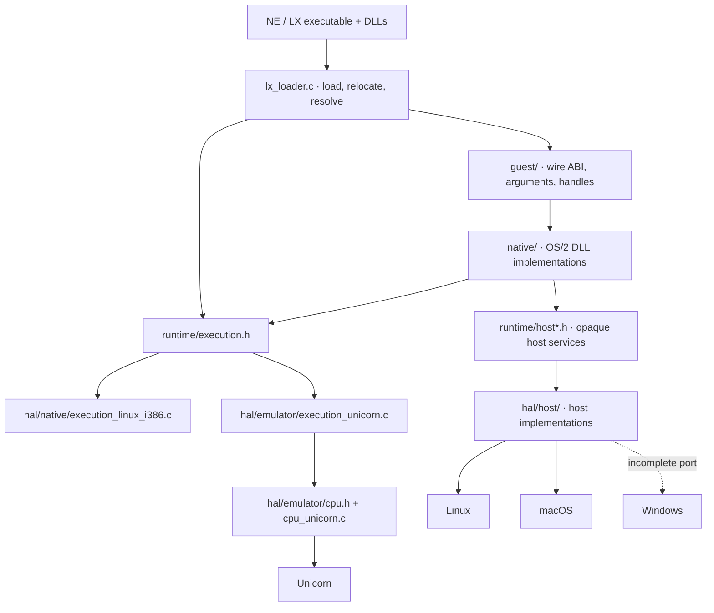
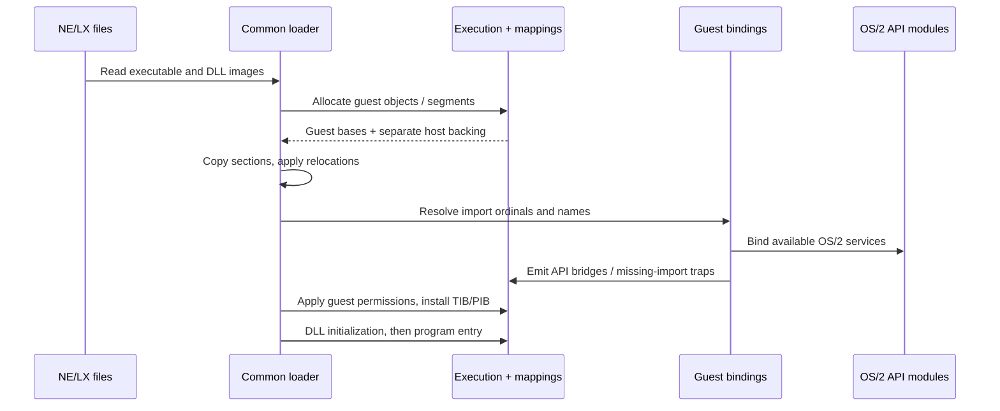
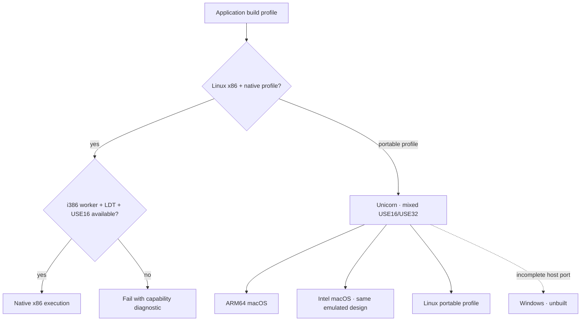
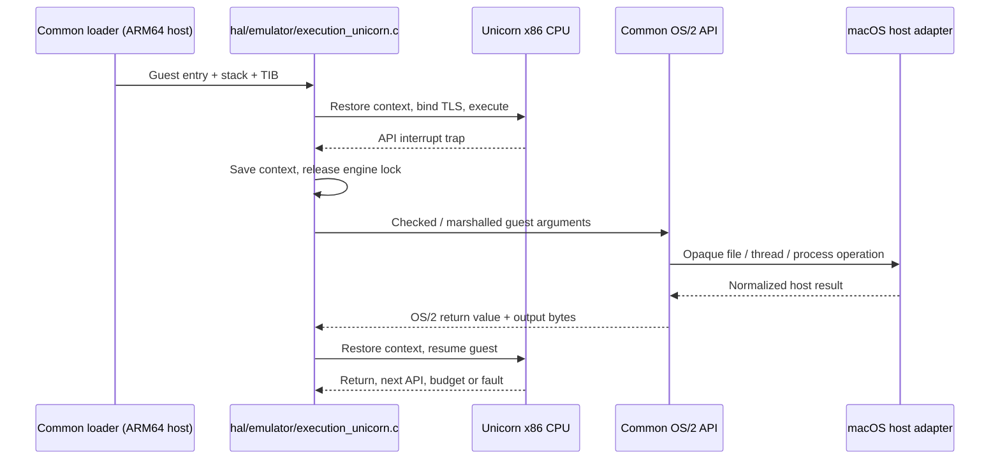
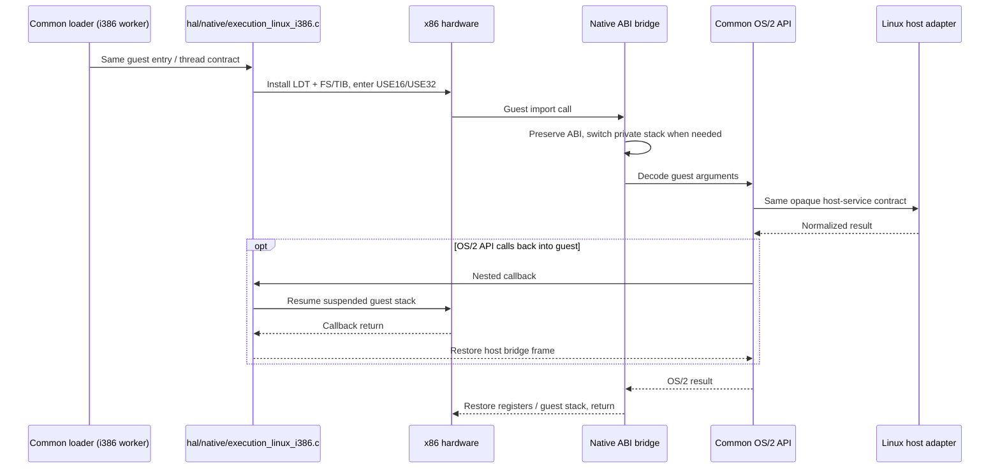
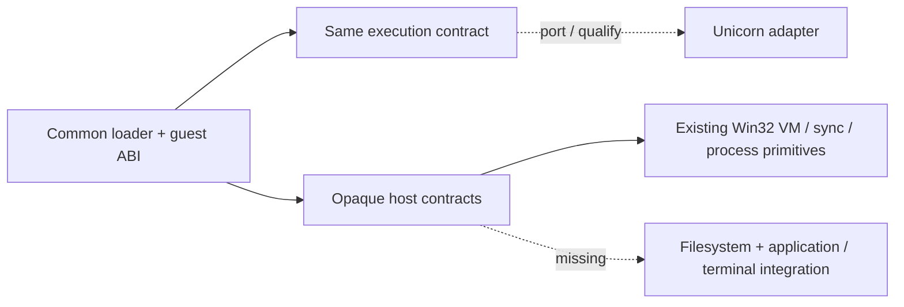
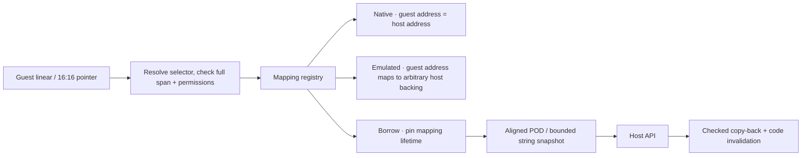
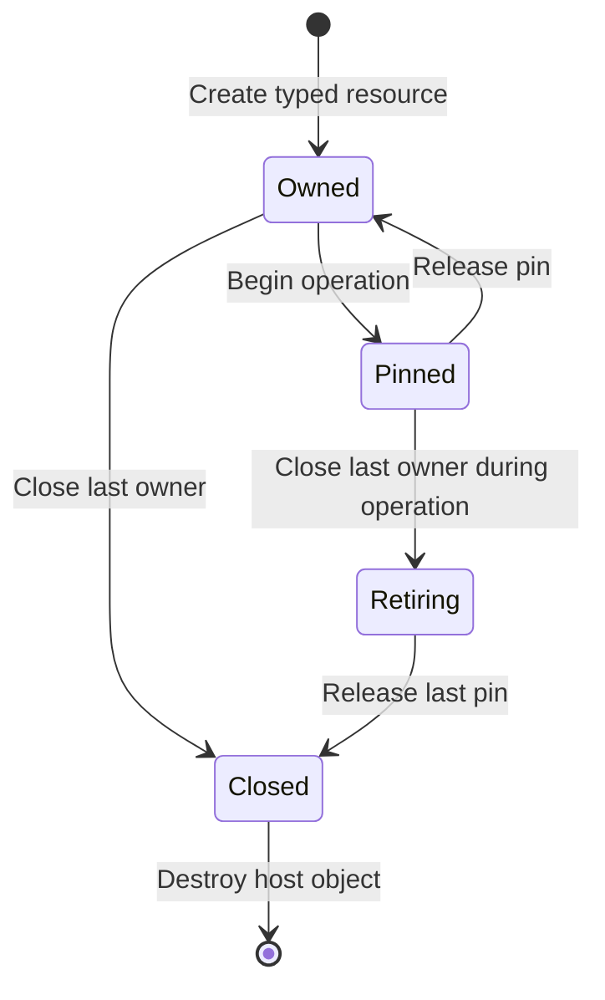
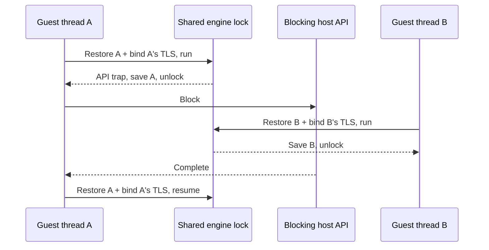

<!-- Public domain. No rights reserved. Wholly AI-authored. -->

# How 2ine works

**One OS/2 loader and API layer. A shared runtime over a hardware abstraction layer.**

## Structure

`native/` contains the OS/2 API implementations shared by both execution paths.
`runtime/` owns execution dispatch, checked guest mappings and platform-neutral
host-service contracts. `hal/` implements those contracts: `hal/native/` owns
Linux i386 execution and ABI bridges, `hal/emulator/` owns CPU emulation, and
`hal/host/` owns host services. Its CMake target selects the implementation and
dependencies for each worker. Execution adapters know no
`LxModule`, `LxMmaps` or `GLoaderState`; they do not load files or implement DOSCALLS.
`tests/check-boundaries.py` checks that source separation.

| Boundary | Owns |
|---|---|
| Common loader | Formats, relocations, imports, modules and OS/2 identity |
| `guest/` | Fixed-width layouts, checked arguments and private resource IDs |
| `runtime/execution.h` | Entries, callbacks, threads, selectors and guest mappings |
| `hal/emulator/cpu.h` | CPU registers, contexts/x87, segments, bounded runs and faults |
| `runtime/host*.h` | VM, files, paths, libraries, clocks, threads, synchronization and child processes |
| `hal/` | Execution backends, native ABI bridges and host-service implementations |

## Loading

NE USE16 segments and LX USE32 objects can coexist. Entry addresses, fixups and
wire pointers use guest addresses. Portable imports require explicit bindings;
an unbound import traps when called. Readable LX objects retain existing 386
execution compatibility, including code stored without an EXEC flag.

## Choosing the execution path

Native eligibility depends on host services, not just the instruction set.
Intel macOS uses emulation too. Explicit backend requests never silently switch;
`auto` chooses among linked capabilities. Current application profiles link one
backend each. Neither Rosetta nor a Linux VM is part of macOS execution.

## macOS: translate, trap, resume

The engine runs bounded slices of up to 10 ms, without an ordinary
per-instruction hook. APIs run with the engine stopped and unlocked. Nested
callbacks preserve complete CPU contexts, including x87 state.

## Linux x86: enter, bridge, return

Native execution owns descriptor syscalls, mode entry, signal handling and
private bridge stacks. Managed thread exit returns to its host entry without
unwinding C frames across machine stacks. Native API modules keep the i386 ABI,
including EAX argument and MSG hidden-word bridges.

## Windows: host port still missing

No Windows application build is claimed. The interfaces avoid POSIX/Windows
objects in guest layouts; the filesystem and application adapter are incomplete.

## Memory and ownership

Guest TIB/TIB2/PIB fields are fixed little-endian widths, never host pointers.
Exact native mappings cannot overwrite occupied worker mappings. Far spans stop
at segment limits. A borrow prevents protect/unmap until release; it does not
prevent concurrent guest writes. Pointer-bearing structures need dedicated wire
marshalling. VioGetMode/VioGetBuf remain unbound in portable USE16 execution.

Guest handles map to private typed resources with generation checks. File IDs,
TIDs and legacy directory IDs have separate OS/2 numbering. Close/reuse cannot
destroy an in-flight file operation. POSIX guards release operation pins on
supported deferred cancellation.

## Threads and reentry

One engine serializes guest CPU execution; host APIs can overlap. Lock order is
mapping registry before CPU engine. Whole segment allocate/free operations are
serialized so a selector cannot be reused midway through retirement. Nested
callbacks save context and restore the outer invocation on return.

Each CLI worker owns one guest address space. Process-wide adapter state does
not support several independent guests embedded in one host process. Child
programs start another worker; POSIX uses `posix_spawn`.

## Why Unicorn?

| Engine | Status / tradeoff |
|---|---|
| Unicorn 2.1.4 | Implemented. QEMU-derived embeddable CPU with explicit memory/context/trap control. |
| Direct QEMU TCG | Needs a maintained execution frontend/internal adapter. Ordinary qemu-user supplies its target OS environment; plugins instrument execution. |
| Bochs | Candidate independent interpreter/reference; needs a CPU embedding adapter. No benchmark or conformance result claimed. |
| Rosetta | Supplies neither Linux descriptor services nor a qualified mixed USE16/USE32 OS/2 path. Unused. |

NE tools and mixed runtime DLLs, including IBM CPPRMI36 and Watcom components,
need 16-bit protected-mode execution even when the final program is 32-bit.

References: [QEMU TCG](https://www.qemu.org/docs/master/devel/tcg.html),
[user mode](https://www.qemu.org/docs/master/user/main.html),
[plugins](https://www.qemu.org/docs/master/devel/tcg-plugins.html),
[Unicorn](https://github.com/unicorn-engine/unicorn/tree/2.1.4),
[Bochs](https://bochs.sourceforge.io/doc/docbook/user/features.html).

## Limits

The worker runs with host process permissions. Bounds checks and typed ownership
reduce accidental corruption; neither native nor emulated execution is a
hostile-code sandbox. Restrict the host process separately for untrusted programs.

Faults/missing imports terminate the worker with diagnostics; full OS/2 exception
delivery is unimplemented. Arbitrary concurrent module load/unload and whole-
loader asynchronous cancellation are outside the supported API scope. Exit with guest threads
leaves module teardown to OS process destruction. Retired DosFreeMem mappings
stay until worker teardown for IBM runtime compatibility. The 16-bit critical
section synchronizes participants without suspending unrelated guest threads.

See [testing](testing.md) for supported toolchain recipes. There is no complete
GUI or DOS execution environment.
