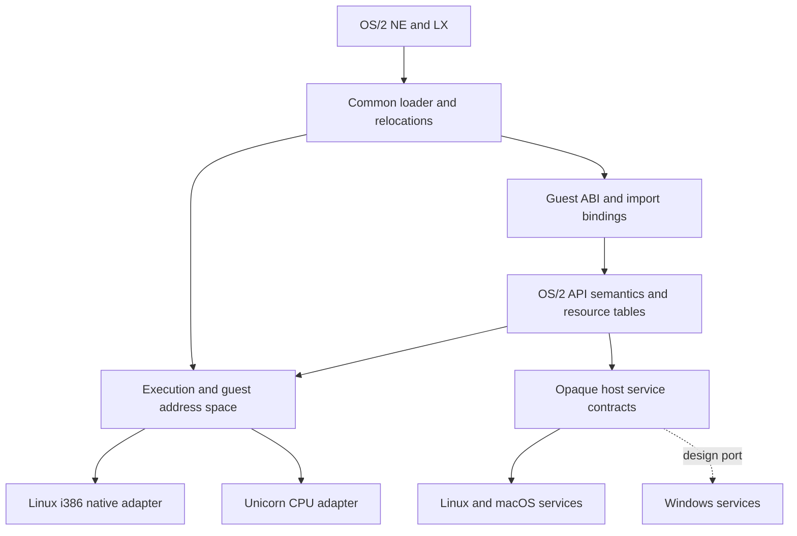

# Execution, guest semantics and host services

The runtime has three independent responsibilities. The common loader and API
modules implement OS/2 behavior. The execution layer enters x86 guest code and
owns its memory/selector/CPU contracts. Host adapters perform external effects.
Native Linux execution is an implementation of the same execution contract as
Unicorn, not an alternate loader.

## Ownership and dependencies

`lx_loader.c` owns NE/LX loading, relocations, dependencies and guest module
identity. `native/doscalls.c`, `msg.c` and `nls.c` own OS/2 semantics and error
translation. Neither CPU adapter knows `LxModule`, `LxMmaps` or `GLoaderState`.
`tests/check-boundaries.py` checks these dependencies and platform calls in the
common loader/core API sources. This lexical check complements runtime tests;
it does not prove all behavior is correct.

`runtime/execution.h` is the common process boundary: program/DLL entry,
USE16/USE32 thread entry, nested callbacks, TIB attachment, selectors, API
bridges, checked mappings, copies and unaligned 32-bit atomic operations.
`runtime/cpu.h` is the lower-level emulated CPU interface: fixed-width x86
registers and segments, opaque complete contexts including x87, bounded runs,
traps/faults and memory/cache operations. Backend-private operations live in
`execution_internal.h` and `cpu_internal.h`; public contracts expose no Unicorn,
POSIX or Windows types.

Host contracts cover VM/clock/calendar/system information (`host.h`), files,
paths and directories (`host_fs.h`), opaque libraries, synchronization, threads,
shared objects and child processes. Host results are normalized before OS/2
error translation. Standard C allocation/string/formatting remain available to
common code for private data. Terminal and SDL UI modules remain separate host
implementations; the portable 32-bit binding set does not qualify PM support.

One CLI worker owns one guest address space. The adapters currently use
process-wide state and are not an API for multiple independent embedded guest
processes inside one host process. Child OS/2 programs launch another worker
through `host_process.h`; POSIX uses `posix_spawn`.

## Addresses, wire ABI and resources

Guest linear addresses and packed 16:16 pointers are 32-bit values; host pointers
are private implementation details. A mapping records guest base, host backing,
permissions and ownership separately. Native execution requires identity
addresses; emulation does not. Exact native maps fail if the host chooses a
different address, without overwriting existing worker mappings.

The guest TIB/TIB2/PIB have fixed wire layouts (`guest/abi.h`), independent of
host pointer width. Private native bridge stacks, emulator contexts and thread
objects never reside in guest TIB fields. A process-wide TLS alias is rebound
to the active thread's TIB by the execution adapter. Each emulator context
preserves its own registers and floating-point state.

Mapping checks validate arithmetic, the complete extent and requested access.
A `LxGuestBorrow` pins backing against protect/unmap and must be released before
its owner is destroyed. API frames and live guest spans can remain pinned over
blocking calls or reentry. Copies isolate aligned host POD objects and strings;
copy-back goes through the backend so translated code is invalidated as needed.
Pins prevent backing destruction, not concurrent guest writes. They are not a
transactional memory or malicious-guest isolation mechanism.

`guest/arguments.*` bounds far spans at the 64-KiB segment end, snapshots strings
and command/environment lists, and aligns copied scalar structures. Generated
USE16 policies are explicit in `api16.json`. Portable USE32 bindings in
`api32.json` use fixed wire sizes and checked copies/borrows. Pointer-bearing
structures require dedicated marshalling. VioGetMode/VioGetBuf have no portable
USE16 binding; unbound portable entries trap lazily. Native USE32 exports retain
the i386 OS/2-compatible C ABI, including special EAX/MSG bridges.

Guest handles do not contain host pointers, file descriptors or Windows HANDLEs.
`guest/handles.*` supplies typed, generation-checked private resources with
ownership and operation pins. OS/2-visible file/TID/legacy-directory numbering
maps to these objects separately. Close/reuse cannot destroy an in-flight file
resource; file operations hold a resource pin and cancellation cleanup guard.
Legacy directory IDs have their own serialized 16-bit table, with system ID 1.
Module identity and references remain common loader state; concurrent module
load/unload is not fully qualified by the current tests.

## Execution, scheduling and faults

Native Linux owns i386 mode entry, LDT descriptors, FS/TIB access, executable
bridges and fault handling. It probes 16-bit descriptor support at startup.
Mixed-mode API bridges use private host stacks with suspended guest-stack
positions for nested callbacks; managed thread exit returns to the host entry
without unwinding C frames across different machine stacks.

Unicorn owns protected-mode descriptors and complete CPU contexts. One engine
is serialized across host threads. Runs yield at a 10-ms bound and API traps;
the engine lock is released before executing an OS/2 API, so another guest
thread can run while an API blocks. Reentrant callbacks save/restore contexts.
There is no per-instruction hook in ordinary execution. Guest memory backing
is shared across contexts; this design favors simplicity over parallel guest
CPU execution. No comparative throughput benchmark is claimed.

Lock order is mapping registry before CPU engine; whole segment allocation/free
is serialized to prevent a selector from being reused between unmap and
retirement. Host API code must not call an engine while retaining a conflicting
lock. Managed thread invocations belong to their caller through cleanup.
POSIX host guards release pinned resources on supported deferred cancellation;
this does not qualify arbitrary asynchronous cancellation throughout the
loader. Process exit with created guest threads leaves code/mapping teardown to
OS process destruction instead of racing live code with DLL unload.

Faults and missing imports fail the worker with diagnostics. Low-level CPU runs
have explicit fault/budget events; the application layer does not yet turn every
CPU exception into OS/2 exception delivery. Retired DosFreeMem mappings are
retained until worker teardown for observed IBM runtime exit compatibility.
The 16-bit critical section synchronizes participating API callers, without
suspending unrelated guest threads.

Native code runs with worker permissions and emulated APIs can access host
files under configured drive/path mappings. Neither adapter is a security
sandbox. Run untrusted programs in an independently restricted OS process or
container. Bounds, typed ownership and process separation reduce accidental
host corruption; they do not establish security equivalence to an OS/2 kernel.
Guest readable/executable permissions preserve existing 386 compatibility,
including readable LX objects that contain callable code; host JIT permissions
are a separate engine responsibility.

## Engine choice and platform capabilities

| Candidate | Fit and tradeoff |
|---|---|
| Unicorn 2.1.4 | Implemented. QEMU-derived embeddable CPU API, memory/context/interrupt control and host portability; the adapter supplies OS/2 segmentation, bridge and thread semantics. |
| QEMU TCG directly | Viable separate integration. Requires a maintained execution frontend/internal API adapter; ordinary qemu-user supplies its target OS environment. TCG plugins instrument execution rather than supplying this embedding boundary. |
| Bochs | Candidate independent interpreter/reference engine. Separating its CPU from its PC frontend needs its own adapter. No implementation or speed/conformance comparison is claimed. |
| Rosetta | Does not supply the required Linux descriptor services or a qualified mixed USE16/USE32 OS/2 execution path. It is not used. |

The Hobbes and compiler survey found real 16-bit-only and mixed executables and
DLLs; a 32-bit-only runtime is insufficient. In the deduplicated 1999 Hobbes
sample, 2,147 native images included 184 16-bit-only and 311 mixed images;
the selected 2024 sample contained 352 and 580 respectively among 3,442 images.
These are static format/code-object observations, not archive-wide execution
results. IBM CPPRMI36 and Watcom's compiler/linker suite also exercise segmented
code in otherwise 32-bit pipelines.

Native eligibility means Linux i386 ABI, LDT support and 16-bit descriptor
capability, not merely an x86 host. ARM64 macOS uses Unicorn; Intel macOS also
uses Unicorn. Linux x86 can select an explicitly built portable loader. Current
application profiles link one backend each; `auto` chooses among linked
capabilities and does not download or launch an emulator. Windows needs a
filesystem adapter, build/terminal integration and platform qualification.
Existing Win32 service branches are unverified implementation starting points,
not a supported Windows runtime. Other host CPU architectures require their
own build/execution qualification.

Primary engine references: [QEMU TCG](https://www.qemu.org/docs/master/devel/tcg.html),
[QEMU user mode](https://www.qemu.org/docs/master/user/main.html),
[TCG plugins](https://www.qemu.org/docs/master/devel/tcg-plugins.html),
[Unicorn](https://github.com/unicorn-engine/unicorn/tree/2.1.4), and
[Bochs features](https://bochs.sourceforge.io/doc/docbook/user/features.html).
