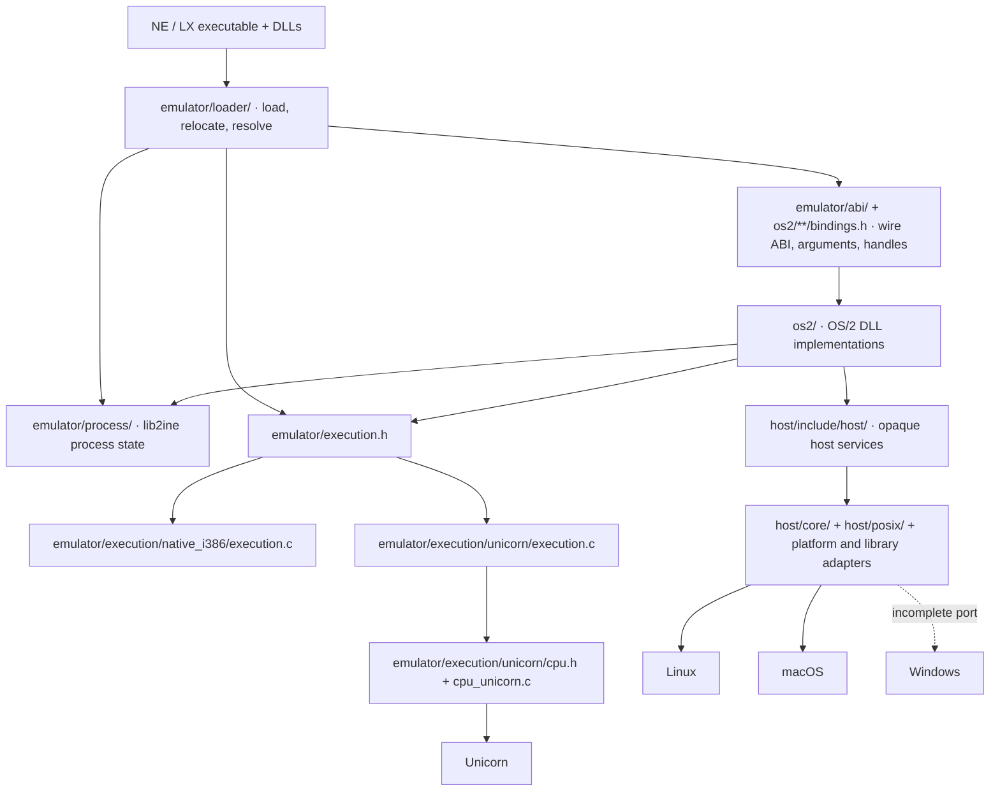
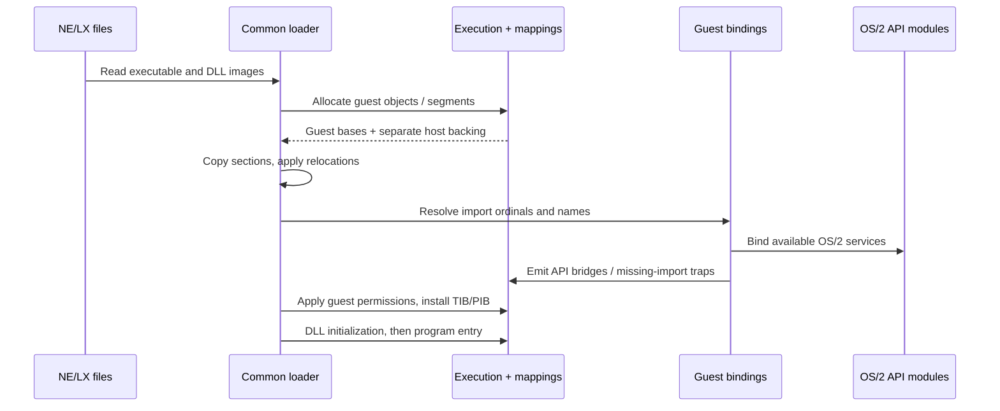
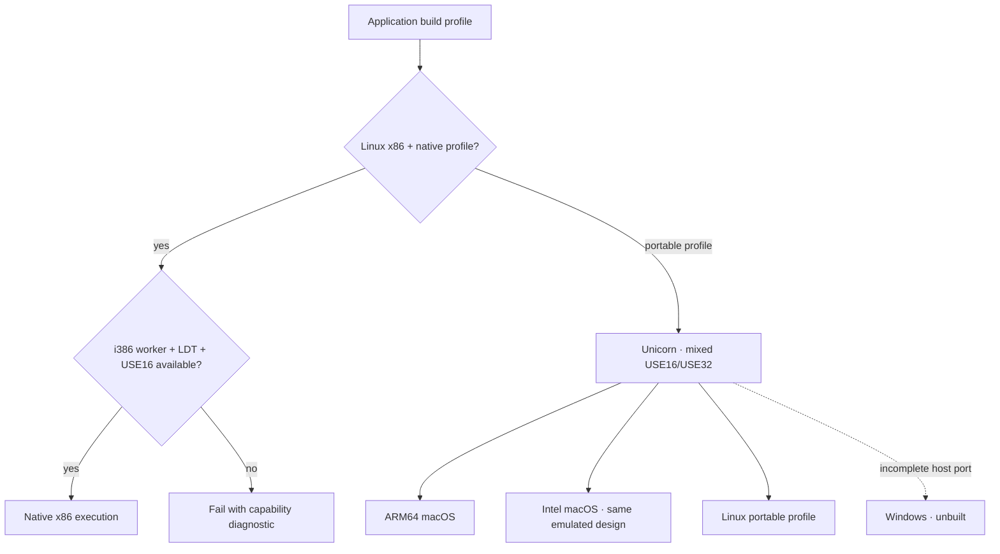
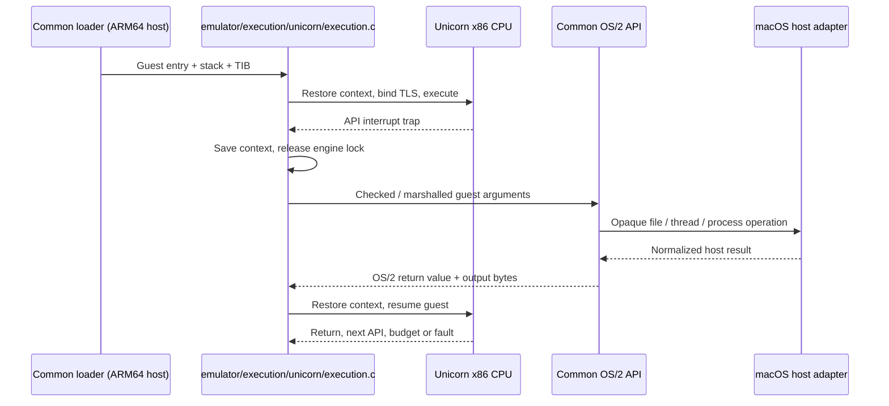
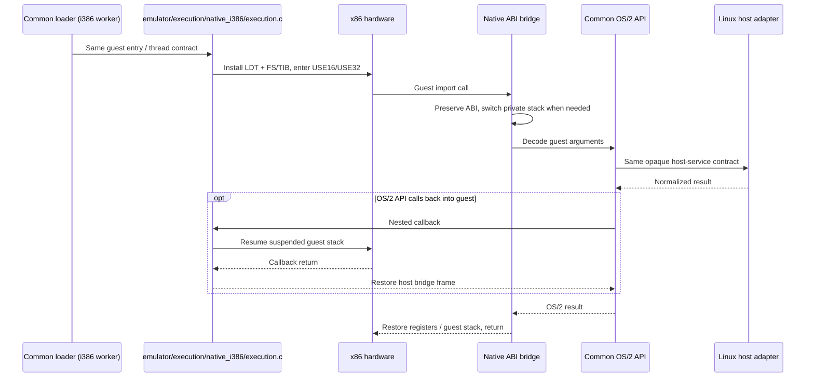
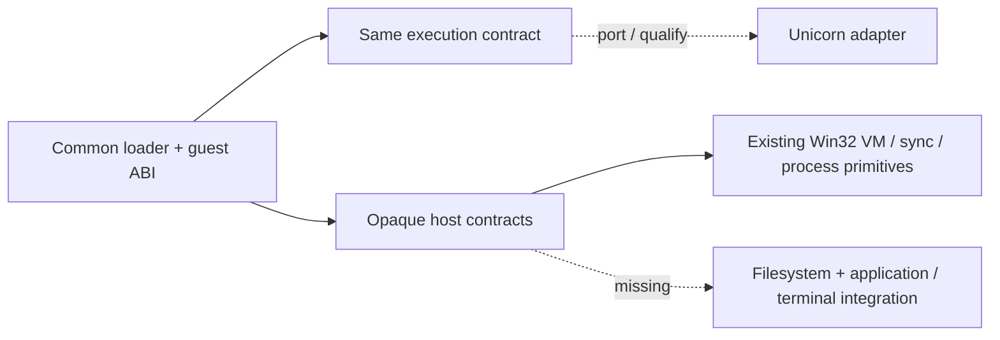
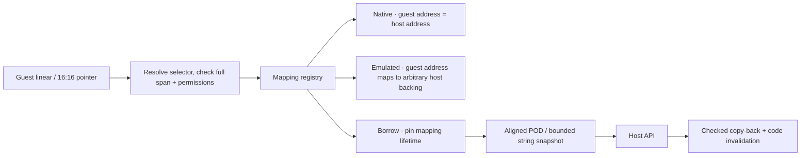
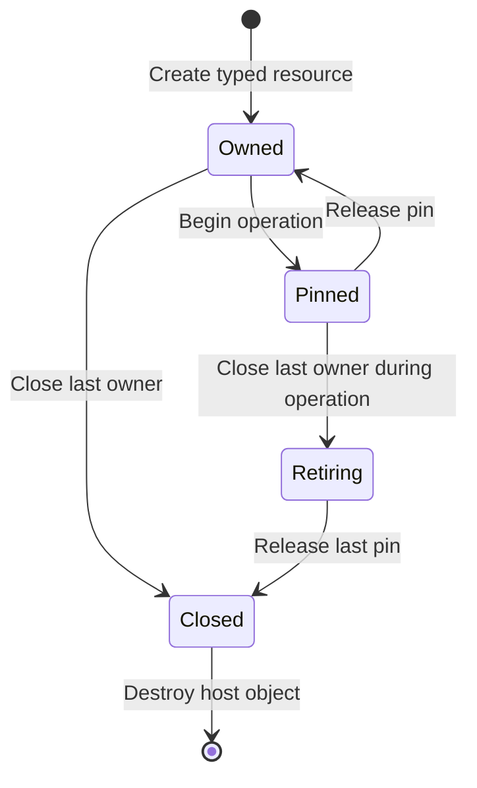
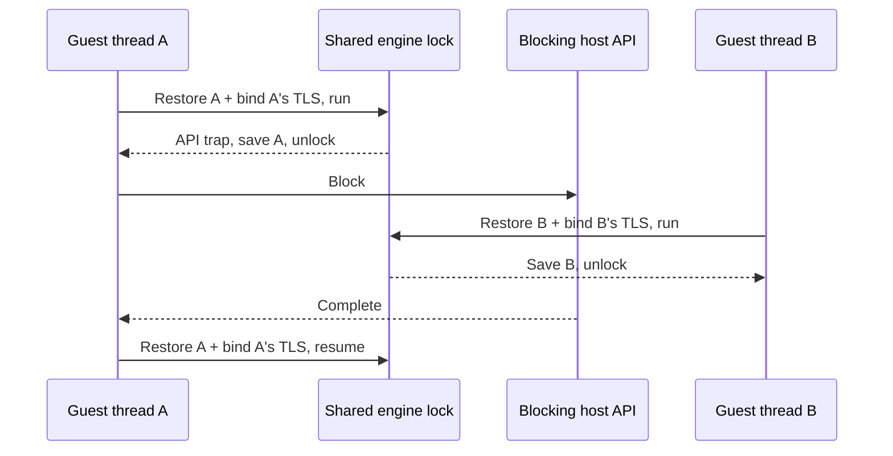

<!-- Public domain. No rights reserved. Wholly AI-authored. -->

# How 2ine works

**One OS/2 loader and API layer. A shared runtime over a hardware abstraction layer.**

## Structure

`os2/` contains the OS/2 API implementations shared by both execution paths, grouped
like IBM's component build trees ([OS/2 DLLs](../os2/README.md)).
`emulator/` owns the loader, the OS/2 process runtime (`lib2ine`), the guest ABI
helpers and execution: dispatch and checked guest mappings in
`emulator/execution/core/` ([emulator](emulator.md)). `host/include/host/` declares host-service contracts,
and `host/` implements them as a platform-free core (`host/core/<function>/`)
plus adapters that mirror it (`host/<adapter>/<function>/`): `host/posix/`
shares host services between `host/linux/` and `host/macos/`, and `host/win/`
contains partial Windows adapters. `emulator/execution/native_i386/` owns
Linux i386 execution and ABI bridges and `emulator/execution/unicorn/` owns CPU
emulation. [Host adapter selection](host.md) chooses the implementation and
dependencies for each worker. Execution adapters
know no `LxModule`, `LxMmaps` or `GProcessState`; they do not load files or implement
DOSCALLS.
`tests/architecture/check_boundaries.py` checks that source separation.

The include roots are the project root, `host/include`, `storage/include` and
`emulator/include`.
Project headers are included by their path from the project root
(`"os2/include/pmwin.h"`, `"storage/common/file_time.h"`), public host headers as
`"host/<name>.h"`, public storage headers as `"storage/<name>.h"` and public
emulator headers as `"emulator/<name>.h"`; same-directory
names and `../` paths are rejected. Host-OS preprocessor branches (`_WIN32`,
`__APPLE__`, `__linux__`) appear only in `host/linux/`, `host/macos/`, `host/win/`
and `emulator/execution/native_i386/`, and in the storage host adapters `storage/common/host*` (file open/lock/sync,
identity, local time and locks), apart from the named temporary allowances in the
checker. `formats/` includes no other component, `storage/` only `formats/`.
The ball store (`ball/`) keeps settings, files and references and includes no
installation or launch code; the installation manager (`environment/`) and
launch planning (`emulator/launch/`) reach it only through `ball/store.h`, and
only the JSON facade (`ball/facade/`) composes them. Applications (`apps/`) use
the engine's JSON ABI only. `emulator/` outside `emulator/launch/` does not
include `ball/`, `environment/` or `os2/`, and its layers (execution, ABI,
process, loader) include only downwards. Inside `os2/`, sources use only the known IBM groups; each DLL directory has
one module definition, and its generated table is included only by its
`module.c`. A DLL reaches another DLL's internals through
`os2/include/private/`; the remaining direct includes of another DLL's
headers are counted in the checker. Inline assembly appears only in `emulator/execution/native_i386/`. Outside `host/`, code includes only the public
host contracts; `host/core/` and `host/include/` use no host APIs. Every top-level source directory is classified in
the checker, so a new component is covered by these rules.

| Boundary | Owns |
|---|---|
| `emulator/loader/` | Formats, relocations, imports, modules and OS/2 identity |
| `emulator/process/` | Process state, PIB, TIBs, segments, drives and paths |
| `emulator/abi/` | Fixed-width layouts, checked arguments and private resource IDs |
| `emulator/execution.h` | Entries, callbacks, threads, selectors and guest mappings |
| `emulator/execution/unicorn/cpu.h` | CPU registers, contexts/x87, segments, bounded runs and faults |
| `host/include/host/*.h` | VM, files, paths, libraries, clocks, threads, synchronization, child processes, windows, input, audio and other host services |
| `host/` | Host-service core and adapters |
| `emulator/execution/` | Execution backends and native ABI bridges |

## Source ownership

| Directory | Contents |
|---|---|
| `formats/executable/` | Packed NE/LX definitions and LX EXEPACK decompression, without process state; built as `twoine_formats` (OS/2 application ABI) and `twoine_formats_host` (host ABI) |
| `formats/resources/` | OS/2 and Windows icon bitmaps and NE/LX resource extraction |
| `formats/audio/` | Sound bank recognition (SoundFont, DLS, SFZ) |
| `ball/` | The ball store: manifest, settings, drive table and references, guest/host paths, files, launcher records, configuration-file editing and packages; `store.h` is its C interface, `facade/` the JSON `tb_request` facade (library `twoine_ball`). See [ball.md](ball.md) and `ball/README.md` |
| `environment/` | The OS/2 installation manager: installation media, the component ledger and operations, dependency audits, install receipts, Workplace Shell launchers and sound banks. See [environment.md](environment.md) |
| `emulator/launch/` | Launch planning for a ball: runtime selection and features, the guest and host environments, the `system.*` schema, `2ine.cfg` and `audio.conf`, arguments, prerequisites and the launch plan |
| `os2/config/` | Codecs for OS/2's configuration files: INI profiles (native and 2INEPRF1), CONFIG.SYS statements and search lists, Workplace Shell object records and setup strings; shared by PMSHAPI, PMWP and the ball |
| `apps/cli/` | `2ine-ball`, the command-line client of the JSON facade |
| `storage/` | Disk images, filesystems (ISO 9660, FAT, HPFS) and archive containers shared by the host services and ball; public interface in `storage/include/storage/`; built per ABI by `twoine_add_storage` |
| `emulator/loader/` | Entry, imports/relocations, NE/LX loading, module lifetime, module diagnostics and the REXX service worker |
| `emulator/process/` | Bootstrap, PIB, process peers, threads/TIBs, 16-bit segments, configuration, drives and paths, resolver files, launch record and audio generator mixer |
| `emulator/execution/` | Execution dispatch/mappings (`core/`) and the native i386 and Unicorn backends |
| `emulator/abi/` | Argument marshalling and handles; public headers in `emulator/include/emulator/` |
| `os2/include/` | Public OS/2 API headers; `private/` holds cross-DLL internals, the export framework (`export*.h`) and the guest binding policies (`api16.json`, `api32.json`) |
| `os2/<group>/<dll>/` | One DLL: its `<dll>.def` exports, `module.c` entry, sources, guest bindings (`bindings.h`) and generated export table (`generated/<dll>-lx.h`) |
| `os2/baseos/doscalls/` | DOSCALLS, in IBM's kernel unit layout (`filesys/`, `memory/`, `sem/`, `task/`, `loader/`, `dev/`, `perf/`) plus DOSCALL1's ring-3 areas (`doscall1/`: queues, sessions, NLS, messages, Vio, Kbd, suballocation, thunks); see its README |
| `os2/baseos/{quecalls,sesmgr,nls,msg,viocalls,kbdcalls}/` | Forwarder-only DLLs: each export forwards to the DOSCALLS ordinal that implements it, as in Warp 4.52 |
| `os2/ps/pmmerge/` | PMMERGE, the merged PM library, in IBM's source layout: `pmwin/` (windows, messages, input, painting, dialogs), `pmgre/` (graphics engine entries), `ishapi/` (profiles, switch list, WinStartApp); see its README |
| `os2/ps/{pmwin,pmshapi,pmgre}/` | Forwarder-only DLLs: each export forwards to the PMMERGE ordinal that implements it, as in Warp 4.52 |
| `os2/mm/mmpm/` | MMPM, the merged MMPM/2 library: `mci/` (MCI dispatch in `mdm/`, waveaudio DART in `admc/`, sequencer in `mimc/`, digital video in `svmc/`) and `mmio/mmio/`; see its README |
| `os2/mm/{mci/mdm,mmio/mmio}/` | Forwarder-only DLLs: each export forwards to the MMPM ordinal that implements it, as in Warp 4.52 |
| `os2/registry/reg32/` | REGISTRY: the Reg* entries, which PMWINX forwards to at Warp's ordinals |
| `os2/mptn/common/` | Socket layouts, socket errors and host lookups shared by TCPIP32, SO32DLL and TCP32DLL |
| `tools/` | Generators, import analysis, assembly conversion and `lx_dump` |
| `tools/data/` | Ordinal catalogue |
| `tests/` | Host, emulator, OS/2 library, tools, architecture and integration tests; guest programs/fixtures |
| `research/` | Format specifications and isolated experiments |

Component CMake files own their targets. Generated tables are included only by
their module's entry unit; private split-unit headers do not extend the public
OS/2 API.

PM child windows share their top-level host render target. Clipping honors both
class and window styles; frame statics preserve their interiors and pass pointer
hit tests through to the controls underneath. Exposure invalidates one window
tree. Message retrieval synthesizes low-priority paint requests from persistent
update regions, after posted messages and before timers, with parents painted
before children. Retrieving a paint request does not validate the update region;
BeginPaint or default paint processing does. Disabling window updates suspends
paint delivery while retaining damage; reenabling alone does not force redraw.
Presentation coalesces damaged
windows with a bounded delay. Both message retrieval paths pump host events
even when guest timers keep the queue busy.

PM clipboard metadata and system atoms are shared within the worker process.
This does not synchronize with the host clipboard. Clipboard data currently
supports handles and caller-owned pointers; transferring ownership of guest
pointer allocations and delayed rendering remain unsupported. Open32 standard
cursors use the PM system-pointer service.

## Loading

NE USE16 segments and LX USE32 objects can coexist. Entry addresses, fixups and
wire pointers use guest addresses. Portable imports require explicit bindings;
an unbound import traps when called. Readable LX objects retain existing 386
execution compatibility, including code stored without an EXEC flag.

## Choosing the execution path

Native eligibility depends on host services, not just the instruction set.
Intel macOS uses emulation too. Explicit backend requests never silently switch;
`auto` chooses among linked capabilities. Current application profiles link one
backend each. Neither Rosetta nor a Linux VM is part of macOS execution.

## macOS: translate, trap, resume

The engine schedules slices of up to 4,096 translated blocks. Checking block
boundaries avoids a callback on every guest instruction and a watchdog thread
on every guest API call. Exact instruction and time budgets remain available
through the CPU interface. Register transfers use Unicorn's batch interface;
API traps use an address hash index and reuse CPU snapshots. APIs run with the
engine stopped and unlocked. Nested callbacks preserve complete CPU contexts,
including x87 state.

## Linux x86: enter, bridge, return

Native execution owns descriptor syscalls, mode entry, signal handling and
private bridge stacks. Managed thread exit returns to its host entry without
unwinding C frames across machine stacks. Native API modules keep the i386 ABI,
including EAX argument and MSG hidden-word bridges.

## Windows: host port still missing

No Windows application build is claimed. The interfaces avoid POSIX/Windows
objects in guest layouts; the filesystem and application adapter are incomplete.

## Memory and ownership

Guest TIB/TIB2/PIB fields are fixed little-endian widths, never host pointers.
Exact native mappings cannot overwrite occupied worker mappings. Far spans stop
at segment limits. A borrow prevents protect/unmap until release; it does not
prevent concurrent guest writes. Pointer-bearing structures need dedicated wire
marshalling. VioGetMode/VioGetBuf remain unbound in portable USE16 execution.

Guest handles map to private typed resources with generation checks. File IDs,
TIDs and legacy directory IDs have separate OS/2 numbering. Close/reuse cannot
destroy an in-flight file operation. POSIX guards release operation pins on
supported deferred cancellation.

## Threads and reentry

One engine serializes guest CPU execution; host APIs can overlap. Lock order is
mapping registry before CPU engine. Whole segment allocate/free operations are
serialized so a selector cannot be reused midway through retirement. Nested
callbacks save context and restore the outer invocation on return.

Each CLI worker owns one guest address space. Process-wide adapter state does
not support several independent guests embedded in one host process. Child
programs start another worker; POSIX uses `posix_spawn`.

## Why Unicorn?

| Engine | Status / tradeoff |
|---|---|
| Unicorn 2.1.4 | Implemented. QEMU-derived embeddable CPU with explicit memory/context/trap control. |
| Direct QEMU TCG | Needs a maintained execution frontend/internal adapter. Ordinary qemu-user supplies its target OS environment; plugins instrument execution. |
| Bochs | Candidate independent interpreter/reference; needs a CPU embedding adapter. No benchmark or conformance result claimed. |
| Rosetta | Supplies neither Linux descriptor services nor a qualified mixed USE16/USE32 OS/2 path. Unused. |

NE tools and mixed runtime DLLs, including IBM CPPRMI36 and Watcom components,
need 16-bit protected-mode execution even when the final program is 32-bit.

References: [QEMU TCG](https://www.qemu.org/docs/master/devel/tcg.html),
[user mode](https://www.qemu.org/docs/master/user/main.html),
[plugins](https://www.qemu.org/docs/master/devel/tcg-plugins.html),
[Unicorn](https://github.com/unicorn-engine/unicorn/tree/2.1.4),
[Bochs](https://bochs.sourceforge.io/doc/docbook/user/features.html).

## Limits

The worker runs with host process permissions. Bounds checks and typed ownership
reduce accidental corruption; neither native nor emulated execution is a
hostile-code sandbox. Restrict the host process separately for untrusted programs.

Faults/missing imports terminate the worker with diagnostics; full OS/2 exception
delivery is unimplemented. Arbitrary concurrent module load/unload and whole-
loader asynchronous cancellation are outside the supported API scope. Exit with guest threads
leaves module teardown to OS process destruction. Retired DosFreeMem mappings
stay until worker teardown for IBM runtime compatibility. The 16-bit critical
section synchronizes participants without suspending unrelated guest threads.

See [testing](testing.md) for supported toolchain recipes. The [GUI subset](gui.md) runs selected PM/GPI applications and a bounded native
Word Pro editing workflow. Menus, dialogs, fonts and bitmap drawing are partial;
a complete desktop remains unsupported. There is no DOS
execution environment.
