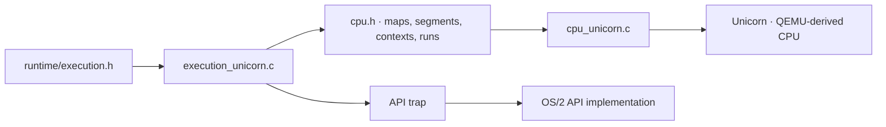

<!-- Public domain. No rights reserved. Wholly AI-authored. -->

# Emulation

**Execute OS/2 x86 code on other CPUs.** Unicorn runs mixed 16/32-bit protected
mode. Code lives in `emulator/`; the common loader and OS/2 APIs stay outside it.

| File | Job |
|---|---|
| `execution_unicorn.c` | Entries, callbacks, threads and API traps |
| `cpu.c`, `cpu.h` | Checked memory and engine-neutral CPU contract |
| `cpu_unicorn.c` | Unicorn registers, descriptors, contexts and cache |
| `CMakeLists.txt` | Emulator sources and Unicorn dependency |

Unicorn 2.1.4 is implemented. Direct QEMU TCG and Bochs adapters are alternatives,
not shipped backends. [Tradeoffs and platform paths](architecture.md).

Wholly AI-authored adapter files are public domain. Unicorn itself is GPLv2;
its code and linked-distribution obligations remain separate.
[Licensing](licensing.md) · [Build](build.md).
