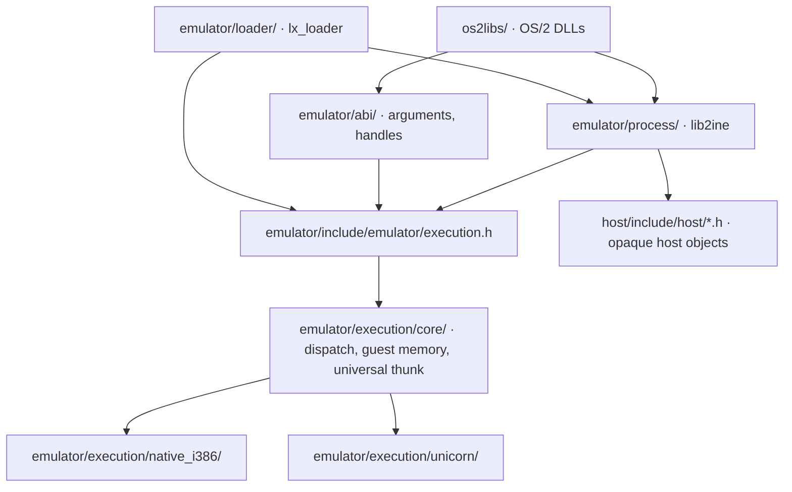

<!-- Public domain. No rights reserved. Wholly AI-authored. -->

# Emulator

**The loader, the OS/2 process runtime and execution, above the host services.**
`emulator/` holds everything that runs an OS/2 program except the OS/2 API
implementations (`os2libs/`) and the host services (`host/`).

| Directory | Contents | Built as |
|---|---|---|
| `emulator/include/emulator/` | Public headers, included as `"emulator/<name>.h"`: `execution.h`, `abi.h`, `arguments.h`, `handles.h`, `module.h`, `runtime.h` (`LxProcessState GProcessState`), `process.h`, `paths.h`, `features.h`, `audio_mixer.h`, `launch_record.h`, `resolver_files.h`, `diagnostics.h` | |
| `emulator/execution/core/` | Backend selection and dispatch (`dispatch.c`), checked guest mappings (`memory.c`), the THK16 universal thunk; `backend.h` is the backend operations table | `twoine_runtime` (portable), or compiled into the native `lib2ine` |
| `emulator/execution/native_i386/`, `unicorn/` | The execution backends, built into the host services object of the worker that runs them | host objects |
| `emulator/abi/` | Checked USE16 argument marshalling and generation-checked OS/2 handles; `twoine_add_abi_arguments()` and `twoine_add_abi_handles()` add them to a consumer | |
| `emulator/process/` | The OS/2 process: bootstrap, PIB (`pib.c`), process peers, threads and TIBs, 16-bit segments, configuration, features, drives (host to OS/2 paths) and `paths.c` (OS/2 to host), resolver files, the audio generator mixer and the launch record | `lib2ine` (`2ine`) |
| `emulator/loader/` | `lx_loader`: NE/LX loading, fixups, imports and forwarders, module lifetime, entry, module diagnostics and the REXX service worker | `lx_loader` |

The layers are checked by `tests/architecture/check_boundaries.py`: execution
and the ABI helpers know no process state; the process runtime holds module
records only by pointer and knows no loader internals; the loader uses the
process runtime through its public headers; nothing in `emulator/` includes
`os2libs/` or the per-DLL bindings in `guest/bindings/`.

`execution.h` covers program/DLL/thread entry, callbacks, bridges and selectors.
`host/*.h` covers files, libraries, threads, processes, synchronization and VM.
Guest addresses, host pointers and host handles are distinct. The guest TIB,
TIB2, TLS block and PIB have one layout, in `emulator/abi.h`; the process keeps
a host-side `LxProcessInfo` whose command line and environment are host pointers.

Until `lx_loader` binds the execution instance (`GProcessState.execution_bound`),
a host program that uses `lib2ine` keeps its main TIB in host memory, has no
16-bit selectors and passes host paths through unchanged. Once bound, TIBs and
selectors live in the execution instance and OS/2 paths map through the drive
table. The OS/2 libraries reach both through the `GProcessState` hooks, which
tests may replace.

`host/CMakeLists.txt` creates separate native and portable host object targets.
`twoine_runtime` combines the execution core and portable host objects in a static
library; the application links the host objects for its selected execution profile. Native ABI
bridges are compiled into their OS/2 API modules.

Embedded Unicorn builds on AArch64 inline the normal exit-flag check and cache
resolved RAM regions alongside page translations. Requested exits still use the
original helper; execution budgets, protection checks and fault handling remain.
Region caching follows translation invalidation, with original lookup paths for
snapshots and MMIO. The build uses a private source copy and enables these changes
only for verified upstream sources; unknown revisions and system libraries retain
the original code. Configure with `-DTWOINE_UNICORN_OPTIMIZATIONS=OFF` to compare
against the unmodified backend.

[Full diagrams](architecture.md) · [Platform adapters](host.md) · [Guest ABI](guest-abi.md) ·
[Licensing](licensing.md).

## Fatal failures

A worker that cannot continue never ends in a host crash dump. It writes a report,
shows one dialog and exits with status 1. Failures arrive by three routes:

| Route | Examples | Context in the report |
| --- | --- | --- |
| `lx_host_fatal` | missing import, guest CPU fault, load failure, emulator invariant | guest registers, instruction, stack, calling module |
| Signal handler (emulated workers) | any `abort()`, host `SIGSEGV`/`SIGBUS`/`SIGILL`/`SIGFPE`/`SIGTRAP`/`SIGSYS`, stack overflow on a 2ine thread | host registers, guest invocation chain |
| Launcher | deaths no handler sees, such as `SIGKILL` | the session log |

Reports go to stderr, which is the session log, and to
`<ball>/logs/fatal-<UTC time>-<pid>.txt`. They contain the program, version, command,
selected settings, OS/2 modules, a host backtrace and host image identities. The
whole environment is not copied, because reports are made to be shared.

The dialog is a separate process: `lx_loader --fatal-dialog` re-executes the running
image, because a crashed process cannot safely use AppKit or X11. The worker waits
for it, so its session and application bundle outlive the dialog.

Dialogs default on only for ball launches with a display. A direct `lx_loader` run
reports on its terminal, and dummy or offscreen SDL video is treated as unattended.
A failure after the program requested exit is recorded without a dialog.

Native i386 workers run guest code with guest segment registers, so they keep their
own `SIGSEGV` handling and install no fault handlers. `lx_host_fatal` still applies.

| Variable | Effect |
| --- | --- |
| `TWOINE_FATAL_DIALOG=0` or `1` | Forces the dialog off or on |
| `TWOINE_FATAL_DIALOG=capture:<path>` | Writes the dialog text to a file, for tests |
| `TWOINE_FATAL_DIR` | Overrides the report directory |
| `TWOINE_FATAL_HANDLER=0` | Leaves fault signals alone, restoring native crash dumps and core files for debugging |
