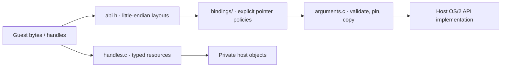

<!-- Public domain. No rights reserved. Wholly AI-authored. -->

# Guest ABI

**OS/2 data stays 16/32-bit, even in a 64-bit host.**

`guest/bindings/api16.json` and `api32.json` select portable imports. Pointer-bearing
structures need wire marshalling. Unbound portable imports trap when called.
Pins hold mappings/resources alive; they do not freeze concurrent guest writes.

Wholly AI-authored files are marked public domain.
[Licensing](licensing.md) · [Execution diagrams](architecture.md).
