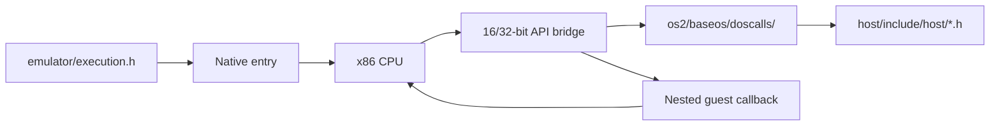

<!-- Public domain. No rights reserved. Wholly AI-authored. -->

# Native execution and OS/2 APIs

**Linux i386 runs guest instructions directly.** `emulator/execution/native_i386/`
owns LDT selectors and FS/TIB setup (`selectors.c`), program, NE and DLL entry
and missing-import trampolines (`entry.c`), fault emulation and the SIGSEGV
handler (`faults.c`), mixed-mode bridges, threads and callbacks (`bridges.c`)
and the backend state and operations table (`execution.c`).

`emulator/execution/native_i386/` also supplies the i386 ABI bridges compiled into the API modules.
`os2/` contains OS/2 DLL implementations shared by native and emulated
execution. Host services use shared POSIX and [platform adapters](host.md).
`*-lx.h` files are generated; edit their module definitions, headers or binding policies, then run
`python3 tools/lxapigen.py`.

Native entry needs Linux, a 32-bit x86 worker and `CONFIG_X86_16BIT=y` with LDT
access. Intel macOS uses emulation. [Build](build.md).

Upstream-derived files retain [2ine's license](../LICENSE.txt). New AI-authored
files carry their own public-domain notice. [License map](licensing.md).
