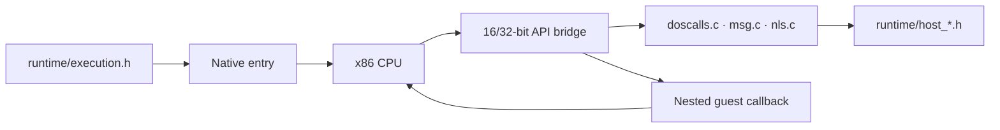

<!-- Public domain. No rights reserved. Wholly AI-authored. -->

# Native execution and OS/2 APIs

**Linux i386 runs guest instructions directly.** `execution_linux_i386.c` owns
LDT selectors, FS/TIB setup, native entry and mixed-mode bridges.

`native/` also contains the original host implementations of OS/2 DLLs.
Both native and emulated execution use those APIs. `*-lx.h` files are generated;
edit their headers/binding policies, then run `python3 lxapigen.py`.

Native entry needs Linux, a 32-bit x86 worker and `CONFIG_X86_16BIT=y` with LDT
access. Intel macOS uses emulation. [Build](build.md).

Upstream-derived files retain [2ine's license](../LICENSE.txt). New AI-authored
files carry their own public-domain notice. [License map](licensing.md).
