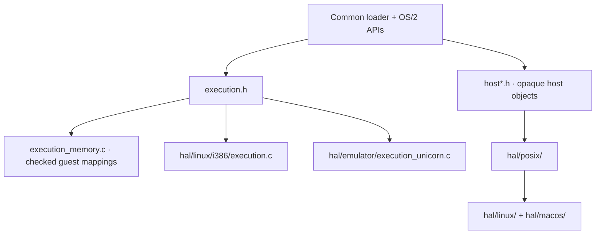

<!-- Public domain. No rights reserved. Wholly AI-authored. -->

# Shared runtime

**Shared contracts above the HAL.** `runtime/` owns execution dispatch and checked
guest mappings. `hal/` implements execution and host services; neither backend
owns the loader or OS/2 behavior.

`execution.h` covers program/DLL/thread entry, callbacks, bridges and selectors.
`host*.h` covers files, libraries, threads, processes, synchronization and VM.
Guest addresses, host pointers and host handles are distinct.

`hal/CMakeLists.txt` creates separate native and portable HAL object targets.
`twoine_runtime` combines the common runtime and portable HAL in a static library;
the application links the HAL for its selected execution profile. Native ABI
bridges are compiled into their OS/2 API modules. Existing build options and
runtime target names select the same execution profiles.

Embedded Unicorn builds on AArch64 inline the normal exit-flag check and cache
resolved RAM regions alongside page translations. Requested exits still use the
original helper; execution budgets, protection checks and fault handling remain.
Region caching follows translation invalidation, with original lookup paths for
snapshots and MMIO. The build uses a private source copy and enables these changes
only for verified upstream sources; unknown revisions and system libraries retain
the original code. Configure with `-DTWOINE_UNICORN_OPTIMIZATIONS=OFF` to compare
against the unmodified backend.

[Full diagrams](architecture.md) · [Platform adapters](hal.md) · [Guest ABI](guest-abi.md) ·
[Licensing](licensing.md).

## Fatal failures

A worker that cannot continue never ends in a host crash dump. It writes a report,
shows one dialog and exits with status 1. Failures arrive by three routes:

| Route | Examples | Context in the report |
| --- | --- | --- |
| `lx_host_fatal` | missing import, guest CPU fault, load failure, emulator invariant | guest registers, instruction, stack, calling module |
| Signal handler (emulated workers) | any `abort()`, host `SIGSEGV`/`SIGBUS`/`SIGILL`/`SIGFPE`/`SIGTRAP`/`SIGSYS`, stack overflow on a 2ine thread | host registers, guest invocation chain |
| Launcher | deaths no handler sees, such as `SIGKILL` | the session log |

Reports go to stderr, which is the session log, and to
`<ball>/logs/fatal-<UTC time>-<pid>.txt`. They contain the program, version, command,
selected settings, OS/2 modules, a host backtrace and host image identities. The
whole environment is not copied, because reports are made to be shared.

The dialog is a separate process: `lx_loader --fatal-dialog` re-executes the running
image, because a crashed process cannot safely use AppKit or X11. The worker waits
for it, so its session and application bundle outlive the dialog.

Dialogs default on only for ball launches with a display. A direct `lx_loader` run
reports on its terminal, and dummy or offscreen SDL video is treated as unattended.
A failure after the program requested exit is recorded without a dialog.

Native i386 workers run guest code with guest segment registers, so they keep their
own `SIGSEGV` handling and install no fault handlers. `lx_host_fatal` still applies.

| Variable | Effect |
| --- | --- |
| `TWOINE_FATAL_DIALOG=0` or `1` | Forces the dialog off or on |
| `TWOINE_FATAL_DIALOG=capture:<path>` | Writes the dialog text to a file, for tests |
| `TWOINE_FATAL_DIR` | Overrides the report directory |
| `TWOINE_FATAL_HANDLER=0` | Leaves fault signals alone, restoring native crash dumps and core files for debugging |
