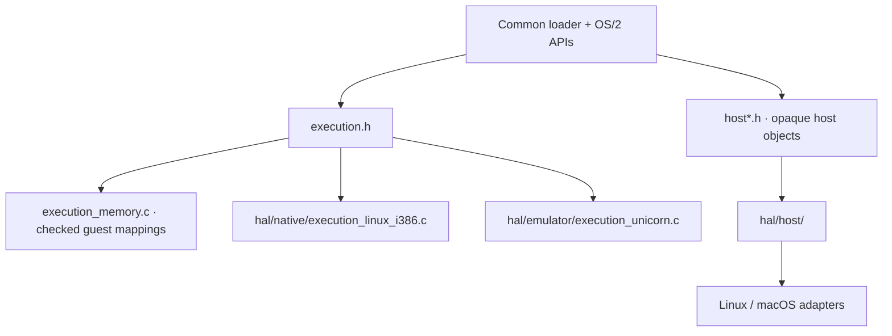

<!-- Public domain. No rights reserved. Wholly AI-authored. -->

# Shared runtime

**Shared contracts above the HAL.** `runtime/` owns execution dispatch and checked
guest mappings. `hal/` implements execution and host services; neither backend
owns the loader or OS/2 behavior.

`execution.h` covers program/DLL/thread entry, callbacks, bridges and selectors.
`host*.h` covers files, libraries, threads, processes, synchronization and VM.
Guest addresses, host pointers and host handles are distinct.

`hal/CMakeLists.txt` creates separate native and portable HAL object targets.
`twoine_runtime` combines the common runtime and portable HAL in a static library;
the application links the HAL for its selected execution profile. Native ABI
bridges are compiled into their OS/2 API modules. Existing build options and
runtime target names select the same execution profiles.

[Full diagrams](architecture.md) · [Guest ABI](guest-abi.md) ·
[Licensing](licensing.md).
