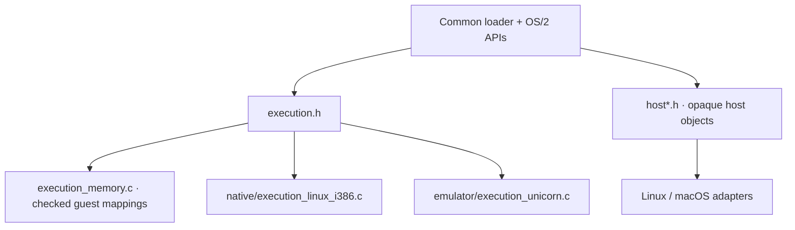

<!-- Public domain. No rights reserved. Wholly AI-authored. -->

# Shared runtime

**One execution boundary. Separate host services.** Neither backend owns the
loader or OS/2 behavior.

`execution.h` covers program/DLL/thread entry, callbacks, bridges and selectors.
`host*.h` covers files, libraries, threads, processes, synchronization and VM.
Guest addresses, host pointers and host handles are distinct.

[Full diagrams](architecture.md) · [Guest ABI](guest-abi.md) ·
[Licensing](licensing.md).
