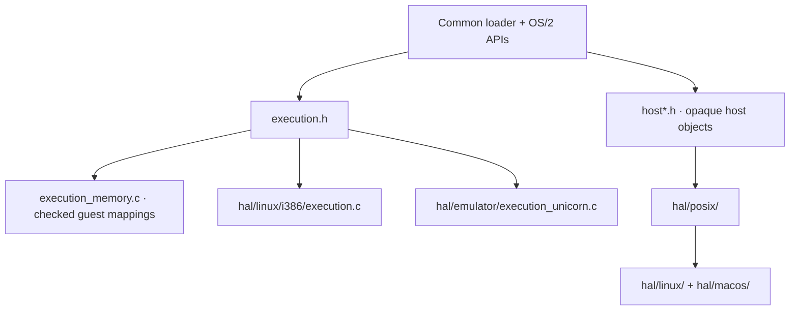

<!-- Public domain. No rights reserved. Wholly AI-authored. -->

# Shared runtime

**Shared contracts above the HAL.** `runtime/` owns execution dispatch and checked
guest mappings. `hal/` implements execution and host services; neither backend
owns the loader or OS/2 behavior.

`execution.h` covers program/DLL/thread entry, callbacks, bridges and selectors.
`host*.h` covers files, libraries, threads, processes, synchronization and VM.
Guest addresses, host pointers and host handles are distinct.

`hal/CMakeLists.txt` creates separate native and portable HAL object targets.
`twoine_runtime` combines the common runtime and portable HAL in a static library;
the application links the HAL for its selected execution profile. Native ABI
bridges are compiled into their OS/2 API modules. Existing build options and
runtime target names select the same execution profiles.

Embedded Unicorn builds on AArch64 inline the normal exit-flag check and cache
resolved RAM regions alongside page translations. Requested exits still use the
original helper; execution budgets, protection checks and fault handling remain.
Region caching follows translation invalidation, with original lookup paths for
snapshots and MMIO. The build uses a private source copy and enables these changes
only for verified upstream sources; unknown revisions and system libraries retain
the original code. Configure with `-DTWOINE_UNICORN_OPTIMIZATIONS=OFF` to compare
against the unmodified backend.

[Full diagrams](architecture.md) · [Platform adapters](hal.md) · [Guest ABI](guest-abi.md) ·
[Licensing](licensing.md).
